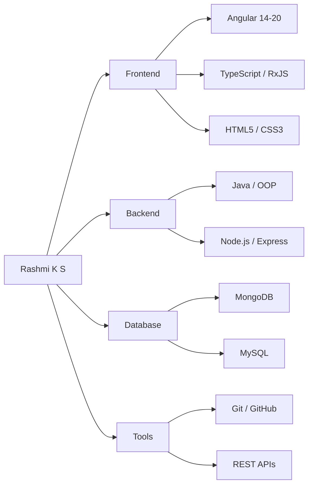
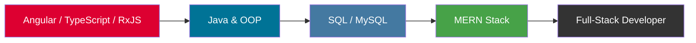
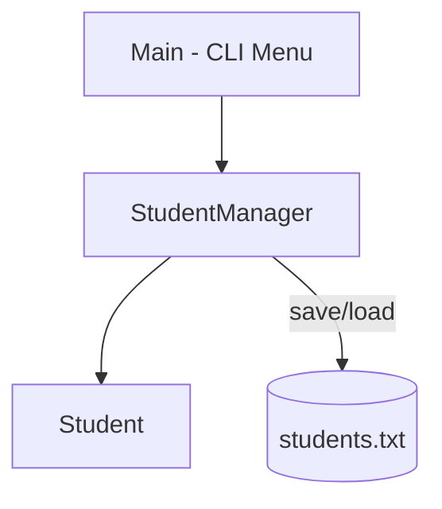
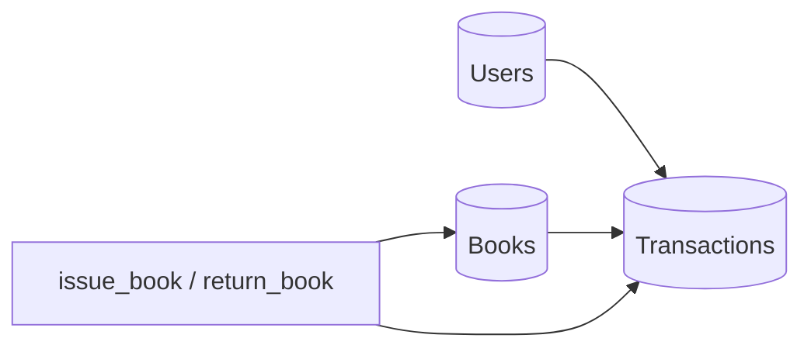

# Hi there, I'm Rashmi KS 👋

🅰️ **Angular Developer | TypeScript | JavaScript | RxJS**
📍 Bangalore, Karnataka | 🚀 Open to Angular / Frontend / Full-Stack opportunities

- 💼 2+ years of professional experience building Angular applications in a client project environment.
- 🔭 Experienced in reusable components, custom directives, RxJS data streams, REST API integration, and performance optimization.
- 🛠️ Building full-stack applications using Angular, Node.js, Express.js, and MongoDB.
- 🤖 Integrated Google's Gemini API to generate AI-powered dashboard explanations in my Employee Management System.
- 🌱 Currently learning Java, SQL, and the MERN stack through the GUVI x HCL program.
- 🎯 Looking for Angular / Frontend Developer roles, with opportunities to grow into full-stack development.
- 📫 [Connect with me on LinkedIn](https://www.linkedin.com/in/rashmiks-dev/)

 

## 🛠️ Tech Stack

 

## 🧭 Skill Map

 

## 🗺️ Learning Roadmap

 

## 📌 Featured Projects

### 📊 Employee Management System — Full-Stack Application with AI

A deployed employee management platform built with Angular, Node.js, Express.js, and MongoDB Atlas, featuring authentication, employee and department management, invoice summaries, and AI-powered dashboard explanations.

**Key Features**
- 🔐 JWT-based authentication, route guards, and HTTP interceptor for attaching authentication tokens.
- 👥 Employee and department management with dashboard summaries.
- 🧾 Invoice management with paid, pending, and overdue invoice statistics.
- 🤖 Gemini API integration for natural-language dashboard explanations, with rule-based insights as a fallback.
- 🏢 Tenant-scoped backend data access for separating tenant data.
- ☁️ Deployed Angular frontend on Vercel and Node.js backend on Render.

**Architecture**

Angular → REST API → Node.js / Express → MongoDB Atlas  
Node.js → Gemini API for AI-generated explanations

**Links**
- 💻 [Frontend Repository](https://github.com/Rashmi92-ha/mini-project)
- ⚙️ [Backend Repository](https://github.com/Rashmi92-ha/mini-project-backend)
- 🌐 [Live Application](https://mini-project-iota-rosy.vercel.app)
- 🔌 [Backend Service](https://mini-project-backend-v057.onrender.com)

**Note:** The backend uses free-tier hosting, so the first request after inactivity may take time to respond.

> 🔑 **Demo login:** `demo@example.com` / `Demo@123`

### ☕ Student Management System (CLI Program)
A scalable, console-driven Java application built entirely around robust architectural foundations to manage student records efficiently.

- 🔹 **Key Implementations:** Engineered utilizing strict Object-Oriented Programming (OOP) methodologies, the Java Collections Framework (`ArrayList`), and native File I/O pipelines to persist state data reliably across separate program lifecycles.
- 📁 **Repository:** [StudentManagementSystem](https://github.com/Rashmi92-ha/StudentManagementSystem)

### 🗄️ Library Management Database (MySQL)
A relational database that manages books, users, and borrowing transactions, with stored procedures for issuing and returning books and views for tracking overdue items and fines.

- 🔹 **Key Implementations:** Designed three related tables with foreign keys and CHECK constraints, wrote stored procedures using transactions and row locking to keep copy counts accurate, and built tracking queries, views, and an index for overdue books and fines.
- 📁 **Repository:** [library-management-db](https://github.com/Rashmi92-ha/library-management-db)

 

## 📊 GitHub Analytics

  

  
  &nbsp;&nbsp;&nbsp;
  

### 📌 Summary Snapshot
- 📦 **9+ public repositories** covering Angular, Java, MySQL and Node.js
- ⚙️ **MEAN stack app** with JWT authentication, route guards, an HTTP interceptor and a responsive data dashboard
- ☕ **Java CLI app** built with OOP, the Collections Framework and File I/O persistence
- 🗄️ **MySQL database** with foreign keys, stored procedures, views and an index for overdue tracking
- 📈 **Next up:** the MERN stack (React) through GUVI x HCL
